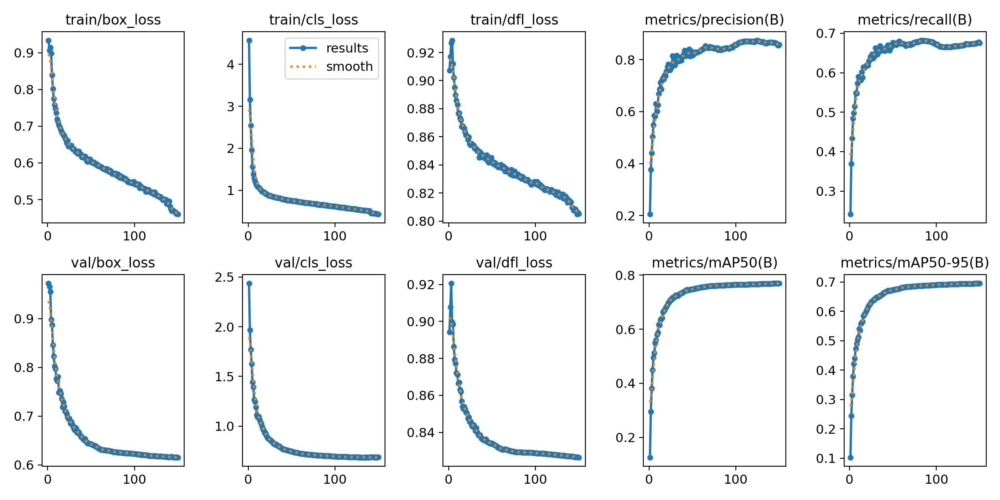
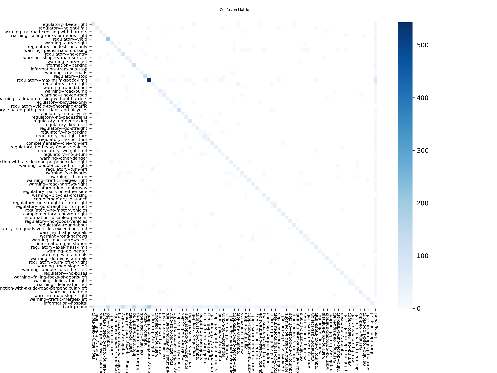

## Signify: An Embedded Assistive Traffic Sign Recognition System for Drivers with Visual Impairments.

- This repository contains the design, training pipeline, and deployment code for my final-year undergraduate project that I successfully defended at Strathmore University.
---

## 1. Project Overview

Signify was developed to address the challenge of driver inattention and visual impairment by engineering a low-power, edge-deployed assistive system. It utilizes a quantized YOLOv8n model to detect 76 distinct traffic signs in real-time, delivering real-time text-to-speech audio alerts to the driver entirely offline. The project demonstrates the viability of shifting heavy ML inference away from host CPUs and directly onto sensor-level AI accelerators.

## 2. Key Features

- **Inference:** The quantized YOLOv8n model is deployed directly onto the Sony IMX500's internal AI accelerator. By offloading inference to the camera sensor, the Raspberry Pi is freed to handle tensor post-processing and application logic.
- **Model Training:** The model was trained from scratch on the Traffic Signs Dataset (Mapillary and DFG), targeting 76 classes specific to the African region across 19,000+ images, achieving a final **mAP50-95 of 69.5%**.
- **Audio Orchestration:** 
    - Implemented string parsing to clean raw class labels (e.g., `regulatory--no_stopping` dynamically converts to "no stopping") for natural `gTTS` audio playback.
    - Implemented a cooldown logic to prevent audio overlap during continuous detection of the same sign.
- **Local Streaming:** Set up a lightweight Flask server on the edge node to stream the annotated video feed and detection bounding boxes over the local network for real-time monitoring.

## 3. System Architecture

The system operates on a decoupled edge architecture:
1. **Vision Node (Sony IMX500):** Captures frames and executes the `packerOut.zip` YOLOv8n inference locally on the sensor. It transmits only the resulting tensor data to the host.
2. **Orchestration Layer (Raspberry Pi 5):** Intercepts the tensor payloads, applies Non-Maximum Suppression (NMS) and confidence filtering, manages the audio pipeline state, and serves the Flask video stream.

---

## 4. Final Training Results

The model was trained for 150 epochs using local GPU compute for over 10 hours.

**Final `best.pt` Model Performance (Validation Set):**
- **mAP50-95 (Primary Metric):** `0.695 (69.5%)`
- **mAP50:** `0.769 (76.9%)`
- **Precision:** `0.858 (85.8%)`
- **Recall:** `0.676 (67.6%)`

### Training Metrics
Metrics from `runs/africa_model_gpu_v1` demonstrating consistent loss convergence and precision scaling across 150 epochs.



### Confusion Matrix
Per-class evaluation indicating strong diagonal classification accuracy across the targeted African traffic sign subset.



---

## 5. Setup and Reproduction

If you have the hardware, you can train the model on your own and deploy it to the Raspberry Pi AI camera by following the instructions below:

### A. Training & Quantization Environment

1. **Clone Repository:**
    ```bash
    git clone [https://github.com/Diing54/signify-traffic-sign-recognition-system.git](https://github.com/Diing54/signify-traffic-sign-recognition-system.git)
    cd signify-traffic-sign-recognition-system
    ```
2. **Environment Setup:**
    ```bash
    conda create -n traffic_signs python=3.9
    conda activate traffic_signs
    pip install -r requirements.txt
    ```
3. **Dataset Preparation:**
    * Download the [Traffic Signs Dataset (Mapillary and DFG)](https://www.kaggle.com/datasets/nomihsa965/traffic-signs-dataset-mapillary-and-dfg).
    * Extract into `dataset/` (git-ignored) and execute the split script:
    ```bash
    python scripts/split_dataset.py
    ```
4. **Train the Model:**
    ```bash
    bash scripts/train_model.sh
    ```
5. **Compile for Sony IMX500:**
    * Exports the `.pt` weights into the `packerOut.zip` format required by the sensor's accelerator.
    ```bash
    python scripts/quantize.py
    ```

### B. Edge Deployment (Raspberry Pi 5)

1. **System Dependencies:**
    ```bash
    sudo apt update
    sudo apt install espeak libespeak1 ffmpeg mpg123 -y
    
    # Python dependencies
    pip install gTTS flask opencv-python pydub --break-system-packages
    
    # Sony AITRIOS application library
    pip install git+[https://github.com/SonySemiconductorSolutions/aitrios-rpi-application-module-library.git](https://github.com/SonySemiconductorSolutions/aitrios-rpi-application-module-library.git)
    ```
2. **Deploy Artifacts to Edge Node:**
    ```bash
    scp deployment/app.py pi@<PI_IP_ADDRESS>:~/
    scp deployment/imx500_model/packerOut.zip pi@<PI_IP_ADDRESS>:~/
    scp deployment/imx500_model/labels.txt pi@<PI_IP_ADDRESS>:~/
    ```
3. **Execution:**
    * Pair the Bluetooth audio device to the Raspberry Pi.
    ```bash
    python app.py
    ```
4. **Stream:**
    * Access the live inference feed via **`http://<PI_IP_ADDRESS>:8000`** on the local network.

---

## 6. License
This project is open-source under the **MIT License**. See `LICENSE` for full details.
